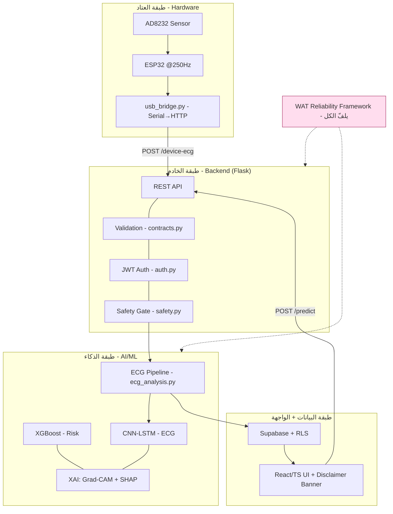
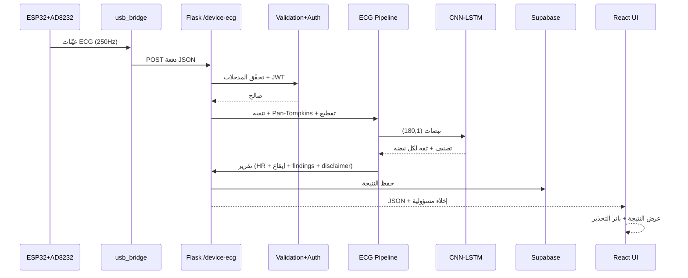
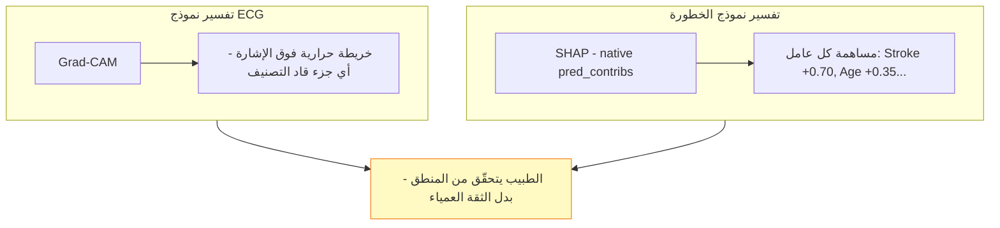
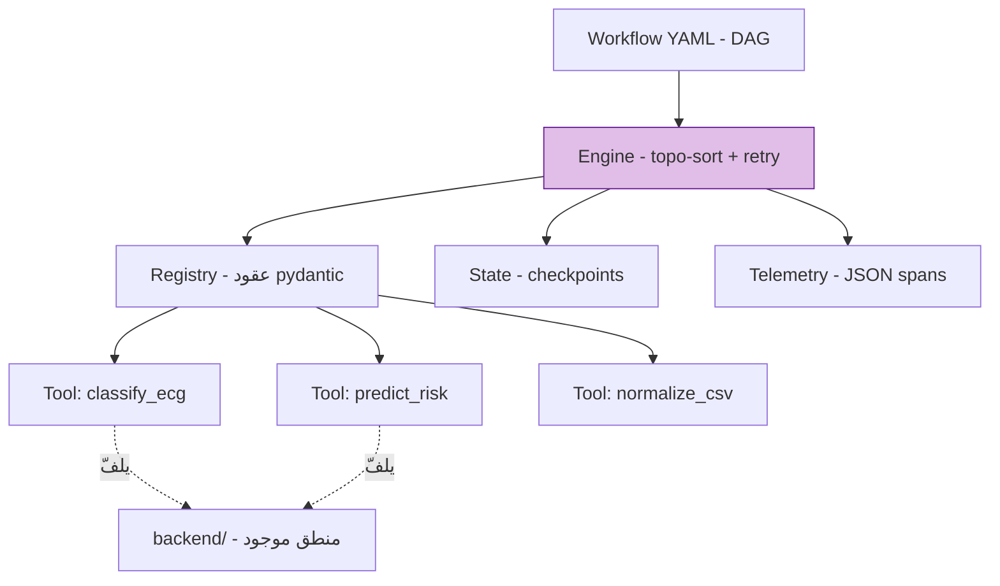

# 🏗️ الرسومات المعمارية — مشروع Cardios

> رسومات جاهزة للكتاب والعرض. كل رسم بصيغة **Mermaid** (تتعرض تلقائيًا في
> GitHub / VS Code / أي عارض Markdown) مع **وصف نصّي** للشرح أمام اللجنة.
> لتصدير صورة: افتح الملف في VS Code (إضافة Mermaid) أو الصق الكود في
> <https://mermaid.live> واحفظه PNG/SVG.

فهرس الأشكال:
- **شكل 1** — المعمارية العامة للنظام (طبقات)
- **شكل 2** — تدفّق البيانات end-to-end (Sequence)
- **شكل 3** — مسار التحليل الحي لإشارة ECG (Pipeline)
- **شكل 4** — معمارية نموذج CNN-LSTM
- **شكل 5** — طبقة التفسير (XAI)
- **شكل 6** — إطار الموثوقية WAT
- **شكل 7** — مخطّط قاعدة البيانات (ER مبسّط)

---

## شكل 1 — المعمارية العامة (Layered System Architecture)



**الوصف:** أربع طبقات (عتاد → خادم → ذكاء → بيانات/واجهة)، يلفّها إطار **WAT**
للموثوقية. كل نتيجة تمرّ عبر **بوّابة الأمان** قبل العرض. النقطة للدكتور: *«النظام
مبني بفصل اهتمامات واضح، والأمان قيد معماري لا إضافة».*

---

## شكل 2 — تدفّق البيانات end-to-end (Sequence)



**الوصف:** يتتبّع طلبًا واحدًا من الحسّاس حتى الشاشة، ويُظهر أين يحدث التحقّق
والتصنيف وإرفاق الإخلاء. مناسب للفصل الرابع (التنفيذ).

---

## شكل 3 — مسار التحليل الحي (Domain-Gap Bridging Pipeline) ⭐

```mermaid
flowchart LR
    A["إشارة خام من الحسّاس - تيار مستمر مشوّش"] --> B["Band-pass Filter - 0.5-40Hz"]
    B --> C["Pan-Tompkins - مشتقة→تربيع→تكامل→عتبة"]
    C --> D["كشف R-peaks - مواضع النبضات"]
    D --> E["تقطيع كل نبضة + Resample → 180"]
    E --> F["تطبيع - min-max"]
    F --> G["CNN-LSTM - تصنيف لكل نبضة"]
    G --> H["تحليل الإيقاع - HR + انتظام RR"]
    H --> I["تجميع - findings + flags"]
    I --> J["+ إخلاء مسؤولية - فرز لا تشخيص"]
    style C fill:#ffe0b2,stroke:#e65100
    style J fill:#ffcdd2,stroke:#b71c1c
```



**الوصف:** **أهم رسم** — يجسّد مساهمتك الأساسية: تحويل إشارة الحسّاس الخام إلى
مدخلات يفهمها النموذج. أبرز **Pan-Tompkins** (البرتقالي) كقلب الحل، و**الإخلاء**
(الأحمر) كنهاية إلزامية.

---

## شكل 4 — معمارية نموذج CNN-LSTM

```mermaid
flowchart LR
    IN["Input (180,1) - نبضة واحدة"] --> C1["Conv1D + ReLU"]
    C1 --> P1["MaxPool"]
    P1 --> C2["Conv1D + ReLU"]
    C2 --> P2["MaxPool"]
    P2 --> L1["LSTM - تسلسل زمني"]
    L1 --> DO["Dropout"]
    DO --> FC["Dense"]
    FC --> OUT["Softmax - 5 فئات AAMI"]
    style C1 fill:#bbdefb
    style C2 fill:#bbdefb
    style L1 fill:#c8e6c9
```



**الوصف:** طبقات **Conv1D** تلتقط الأنماط المحلية في الموجة (شكل QRS)، و**LSTM**
تلتقط التسلسل الزمني، ثم **Softmax** على 5 فئات. الجملة: *«اخترنا الهجين لأن
الإشارة لها بُعدان: شكل محلي + تسلسل زمني».*

---

## شكل 5 — طبقة التفسير (XAI)



**الوصف:** تغطية مزدوجة — تفسير بصري للإشارة (Grad-CAM) وتفسير عددي للعوامل
(SHAP) — تحوّل النظام من صندوق أسود لأداة قابلة للمراجعة الطبية.

---

## شكل 6 — إطار الموثوقية WAT



**الوصف:** الأدوات **تلفّ** منطق `backend/` الموجود (لا تعيد كتابته)، بعقود
إدخال/إخراج، مع نقاط حفظ وتتبّع — ما يجعل التشغيل قابلًا للتكرار والتدقيق.

---

## شكل 7 — قاعدة البيانات (ER مبسّط)

```mermaid
erDiagram
    profiles ||--o{ predictions : "يملك"
    profiles ||--|| extended_profiles : "يمتد"
    profiles ||--o{ user_roles : "له أدوار"
    profiles {
        uuid id PK
        text email
        timestamptz created_at
    }
    predictions {
        uuid id PK
        uuid user_id FK
        jsonb result
        text type
        timestamptz created_at
    }
    extended_profiles {
        uuid user_id PK_FK
        jsonb health_data
    }
    user_roles {
        uuid user_id FK
        text role
    }
```

**الوصف:** مخطّط مطابق لـ `supabase/setup.sql`، نتائج التنبؤ تُخزَّن JSONB مرتبطة
بالمستخدم، مع **RLS** يضمن أن كل مستخدم يرى بياناته فقط.

---

## كيف تصدّر الصور للكتاب
1. **VS Code:** ثبّت إضافة *Markdown Preview Mermaid Support* → افتح الملف →
   من المعاينة احفظ الرسم صورة.
2. **mermaid.live:** الصق كود كل رسم → Export → PNG/SVG (احفظها في `analysis/outputs/diagrams/`).
3. ضع كل صورة في الكتاب برقم وتعليق (Caption) كما في `THESIS_OUTLINE.md`.
